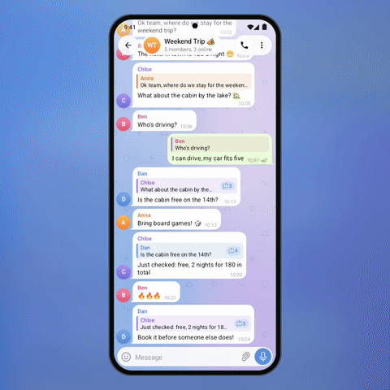

# 🧵 Reply Chain

In busy groups a reply often answers a reply to a reply. A small badge on the quote shows how deep
the chain goes; tapping the quote opens the whole thread in a sheet — oldest first, joined by a
line through the avatars. Tap any message to jump to it in the chat.

<p align="center"></p>

<p align="center"><b>&#9654;&#65039; <a href="demo.mp4">Full-quality video (demo.mp4)</a></b> &middot; Telegram for Android 12.4 design &middot; Android 8+</p>

## How it works

- `ReplyChain.build()` walks `reply_to` links up to 30 messages and reports the first id that
  is not loaded yet (`missing`), so the client can fetch it and refresh the sheet.
- `ReplyChain.depth()` gives the number for the badge.
- `ReplyChainLayout` stacks the bubbles and animates the thread line as they appear.

## Integration into Telegram for Android

| Where | What |
|---|---|
| `ChatMessageCell` reply area | draw the depth badge when `depth > 1` |
| `ChatActivity` → `didPressReplyMessage` | open the chain sheet instead of scrolling; "Show original message in chat" keeps the old behavior |
| `Source.get(id)` | `messagesDict[0].get(id)`; missing ids via `MessagesController.loadMessages` |
| Sheet | `BottomSheet` with `ChatMessageCell`s in a `RecyclerListView` |

Files: [`ReplyChain.java`](reply-chain/src/main/java/org/telegram/ui/Components/ReplyChain.java),
[`ReplyChainLayout.java`](reply-chain/src/main/java/org/telegram/ui/Components/ReplyChainLayout.java).

## Build and run

Requirements: JDK 17 and the Android SDK (platform 36). Point Gradle at the SDK with
`local.properties` (`sdk.dir=/path/to/Android/sdk`) or `ANDROID_HOME`.

```
./gradlew :reply-chain:assembleDebug
adb install reply-chain/build/outputs/apk/debug/reply-chain-debug.apk
```

The app opens on the demo screen and works by hand. For the presentation look of the video:

```
adb shell am start -n org.telegram.lab.replychain/.MainActivity --ez stage true --ez autoplay true
```

## Project layout

| Path | What it is |
|---|---|
| `reply-chain/src/main/java/org/telegram/ui/Components/` | **the feature itself**, drop-in for Telegram's `TMessagesProj` (Android SDK + `AndroidUtilities` only) |
| `reply-chain/src/main/java/org/telegram/lab/replychain/` | the demo screen and the scripted demo used for the video |
| `core/` | Telegram 12.4-style UI the demo is built on: chat screen, bubbles, composer, sheets, menus, Telegram's own icons |

## License

GPL-2.0, same as Telegram for Android, whose icons are included in `core`.